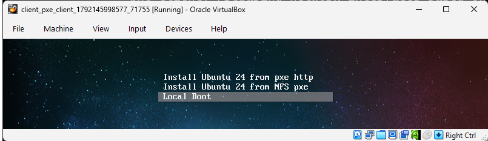

# Vagrant PXE test environment

Forked and modified from https://github.com/eoli3n/vagrant-pxe/tree/pxelinux 

See also [Ubuntu 24.04 – Deploy Ubuntu 24.04 Desktop through PXE (BIOS & UEFI)](https://c-nergy.be/blog/?p=20005)

A vagrant PXE client/server environment which supports virtualbox providers.  

It is designed to learn and test cloning solutions, nfsroot, syslinux, etc...

---
**Exercise 4.1**

Follow the notes below to run a PXE server and a PXE client to simulate an installation of an operating system onto a bare metal server
* Make sure you understand what the server is doing
* Try booting the client into Rocky Linux first
* Restart and let the client install Ubuntu either using the HTTP or NFS selection.
* Now restart the client and do a local boot - it should start up Ubuntu from disk. 

---

## start pxe server

```
cd server
vagrant up
```
The first time you run this project, the example will download an ubuntu 24 iso into `server/www/sharedisos`
This will take about 15 minutes. 
Once you have done this, as long as the iso is present, the example will not need to do it again. 
You can speed things up if you already have the ubuntu-24.04.5-live-server-amd64.iso and place it in the directory.

Note that all `.iso` files are excluded from git by the `.gitignore` file.

Setting up the NFS mount point will also take some time so start up the server early and get a coffee until it completes :).
It should take much less time to set up if you later halt and restart the machine without destroying it.

## start client server

Once the pxe server is up, you can start the client server.

```
cd client
vagrant up
```

The client first loads a rocky linux box. 

We are actually going to pxe boot an ubuntu machine but vagrant still needs a box to start up even though it isn't used in this case.

Looking at the virtualbox ui for the client machine, you will see it first attempts a pxe boot using the pxe boot server.



You will be presented with a menu for either selecting 

`Install ubuntu server from pxe http` or 
`Install ubuntu server from NFS pxe`
or `Local Boot`.

If you choose to `Local Boot` at this point, you will boot into rocky linux which has already been installed in the drive by vagrant.

The `Install ubuntu server from pxe http` option will download an ubuntu iso into memory from the local `nginx` server.
This download will take some time and requires about 16Gb of RAM to be on the server to simulate a RAM disk.

Alternatively, if you choose `Install ubuntu server from pxe nfs`, the pxe boot will use intallation files served using an NFS mount. 
In this case, less memory is required but the tradeoff is that it takes a lot of time and memory to configure the NFS mount point on the PXE server.

In both cases, the pxe boot installation process will start and will overwrite rocky linux on the disk with ubuntu using the `cloud init` configuration.

Once the installation process has completed, the client machine will shutdown.

In order to reboot the client  machine, use `vagrant halt` (even though the machine has already stopped), then `vagant up` to reboot it.

You will be presented with the original pxe boot screen.
DO NOT let the pxe installation proceed. 
Instead, if you choose `Local Boot`, the system will now boot into the newly installed Ubuntu server as the Rocky installation no longer exists.

You can log into the Ubuntu server using the credentials

user: ansible
password: minad1234

(Note that the vagrant command line will appear to fail or time out because vagrant cannot SSH into the machine since it no longer is a vagrant box and does not have a vagrant account).


---
**Exercise 4.2**

Install ansible on the pxe server and use it to install apache on the new Ubuntu machine
* modify the pxe-server vagrant script  to provision an ansible user with ssh keys and to install ansible on the pxe server
* create and test an ansible script to install apache on the new Ubuntu client machine (you should be able to reuse some of the configurations from session 2)
* note that the new ansible account on the client only has a password. How might you automate setting it up to use ssh certificate based authentication?

---


**Refs**

* http://www.syslinux.org/wiki/index.php?title=PXELINUX
* https://help.ubuntu.com/community/DisklessUbuntuHowto

