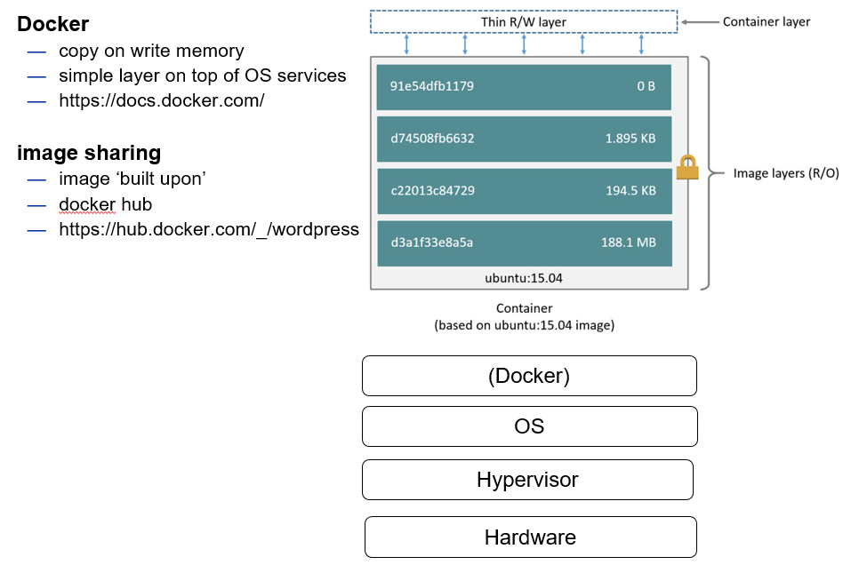

[Main Menu](../../../sessions/README.md) |[session5](../../session1/) | [Session 5 Notes](../docs/sessionNotes.md)

# Session 5 Notes - Docker and Containerisation

We have see how we can automate the instantiation of virtual machines using hypervisors like VirtualBox and rapidly automate this process using Vagrant.
This has allowed us to create experimental proofs of concept rapidly and accurately and if you need to simulate all aspects of a virtual machine's virtual hardware and networking, this is probably the best way to go.
However downloading, installing, configuring and waiting for complete virtual machines to boot is inherently slow.
Even if everything is in place, the initial boot process can take several minutes.

We have also seen that we can use tools like Ansible to orchestrate the installation and configuration of multiple software packages on a fleet of operating systems.
However, this process can also be slow and requires variation depending on which operating system is used as the base.
Many applications need to be deployed across several machines for load sharing at scale perhaps with the database hosted on a cluster of machines and the web front end on another cluster.

The industry has invented a more efficient way of virtualising environments using `containers`.

[What is containerization?](https://www.ibm.com/think/topics/containerization )  

Any application running inside a container appears to have the same environment as it would have if it was running on an operating system on a virtual machine. 
However, instead of installing multiple virtual machines, multiple separate containers can exist and communicate within the same virtual machine and share the core resources of the underlying operating system.
Containers provide several advantages.

* Speed: Containers start up in seconds because they do not boot a full guest operating system.
* Efficiency: They consume fewer system resources than virtual machines, allowing higher density on the same hardware.
* Consistency: It eliminates the "it works on my machine" problem by standardizing the execution environment across development, testing, and production.

Containerisation has a long history but it really began to take off with the introduction of [Docker](https://www.docker.com/) in 2013.
See [A Brief History of Containers: From the 1970s Till Now](https://www.aquasec.com/blog/a-brief-history-of-containers-from-1970s-chroot-to-docker-2016/).

The following image illustrates how Docker works

Docker containers use a `copy on write`  file system which allows each container to be built up in layers. 
Thus we can start `FROM` a base ubuntu system and install any required software to create a new container. 

Many projects create containers which pre-package and make it easy to deploy their software.
If a particular package requires other packages, say a database, then we can use a separate container to provide that service. 
Many large applications are deployed as multiple containers and can increase their capacity by adding more container instances on demand.

Containers can be started and controlled individually using the command line but more often they are managed using orchestration services such as [Docker Compose](https://docs.docker.com/compose/) or [Kubernetes](https://kubernetes.io/) which we will look at later.

For now we will start by installing and testing docker using a simple docker image.

THe first set of examples will use Docker Desktop

---
**Exercise 5.1 Using Docker Desktop**

Go through the exercises in  [Installing and using Docker Desktop](./InstalingAndUsingDockerDesktop.md).
* Installing Docker Desktop (if not installed)
* Running a docker container
* Building a docker container
---

The second set of examples uses Vagrant to install docker on an Ubuntu VM.
After that, you can do the same exercises as in Exercise 5.1 above.

---
**Exercise 5.2 Running Docker in a Linux machine (using Vagrant)**

Go through the exercises in  [vagrant-examples/example5-1](../vagrant-examples/example5_1)
* Installing Docker in Ubuntu using vagrant
* Running a docker container in ubuntu
* Building a docker container in ubuntu
---
