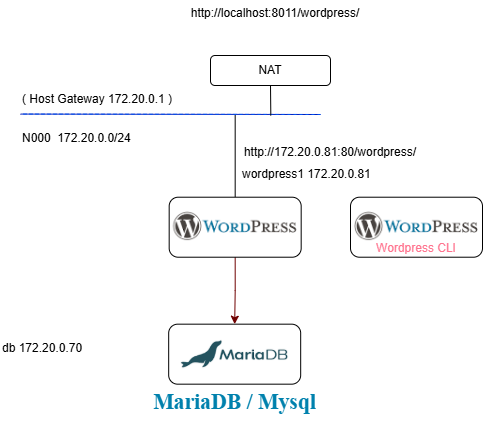

# Example 6.3  Word Press

[Wordpress](https://en-gb.wordpress.org/) is a widely used publishing platform used by millions of sites.
In this example we will set up a simple Wordpress system using Docker Compose.

The image we will use is the official latest Wordpress docker image from [https://hub.docker.com/_/wordpress/tags?name=latest](https://hub.docker.com/_/wordpress/tags?name=latest)

We are also using [Mariadb](https://mariadb.org/) (forked from Mysql) as the back end database.

Mariadb image: [https://hub.docker.com/layers/library/mariadb/10.6.4-focal/](https://hub.docker.com/layers/library/mariadb/10.6.4-focal/)

Finally we are using a companion container called [WordPress CLI](https://en-gb.wordpress.org/cli/) which can run a set of commands to set up the wordpress site when it starts up. 

Image: [https://hub.docker.com/layers/library/wordpress/cli/](https://hub.docker.com/layers/library/wordpress/cli/)

(See also [https://stackoverflow.com/questions/50999848/how-to-run-wp-cli-in-docker-compose-yml](https://stackoverflow.com/questions/50999848/how-to-run-wp-cli-in-docker-compose-yml))

The wordpress-cli container waits for 20 seconds after the project starts to allow the database and the other containers to start before initialising the word press containers, giving them their admin username and password and an initial front page name for the site using the command:

```
      /bin/sh -c '
      sleep 20;
      wp core install --path="/var/www/html/wordpress" --url="http://localhost:8011/wordpress" --title="Simple Local Wordpress By Docker" --admin_user=admin --admin_password=secret --admin_email=foo@bar.com
      '
```

A diagram of the relationship between the containers is shown below



Running the example

```
cd example6-3

docker compose up -d
```

The `-d` makes the containers run as a daemon.

After a few minutes you will see the blog at [http://localhost:8011/wordpress/](http://localhost:8011/wordpress/)

You can log into the site using [http://localhost:8011/wordpress/wp-admin](http://localhost:8011/wordpress/wp-admin)

admin_user=admin

admin_password=secret

These credentials are set in the docker-compose file.

You can log into the running containers using bash with the command 

```
# docker compose exec <container name> bash

docker compose exec wordpress1 bash
```

You can see a log of wordpress queries for each wordpress container using. 

```
# docker compose logs -f <container name>

docker compose logs -f wordpress1
```
If you enter a query, you will see it logged or an error if there is a problem responding.

When you have finished, you can shut down the example using

```
docker compose down

# or to delete the database
docker compose down -v
```