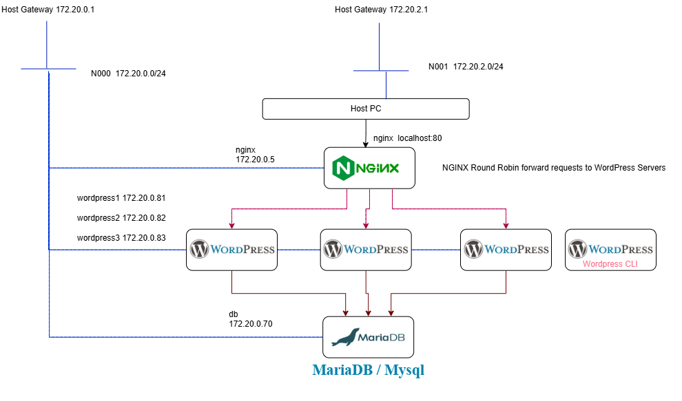
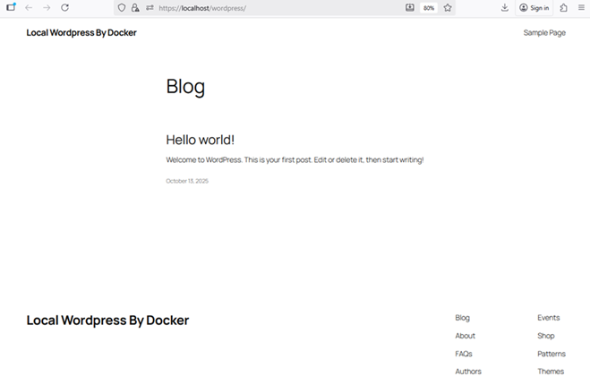
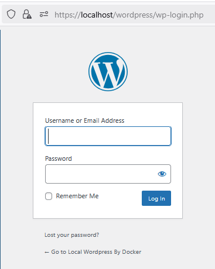
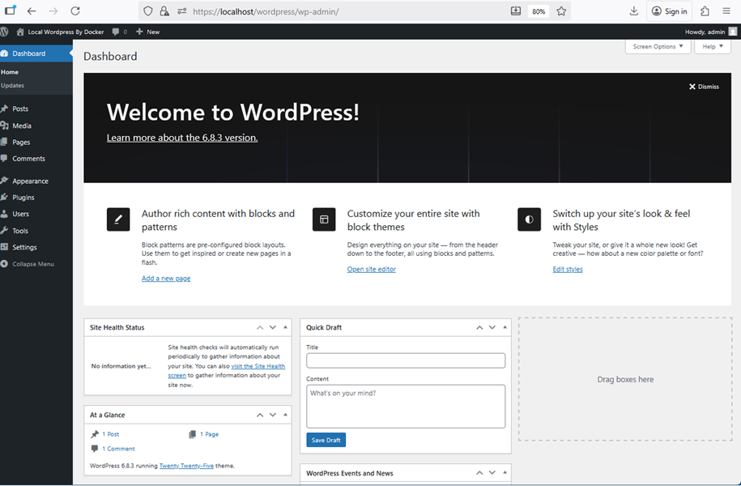
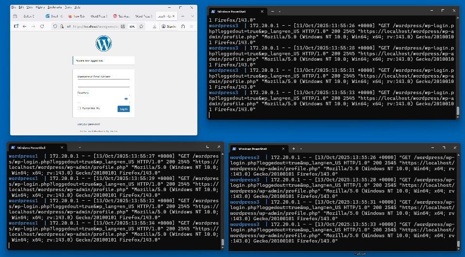

# Example 6.4 Wordpress cluster with a load balancer

This example builds upon Example 6.3 but in this case, we have a cluster of word press servers behind a lad balancer using NGINX.


Often sites are made scalable and more resilient through load-balancing a number of servers. 
In this example we have installed three wordpress servers behind an NGINX load balancer.

All the servers share the same MariaDB database which also maintains the user session data across the servers.



You can see the wordpress configuration if you look at the [docker-compose.yml](./docker-compose.yaml) file.

You will see three Wordpress containers; wordpress1, wordpress2  and wordpress3. 
These all share the same data volume `wp_data` so that they are effectively clones of each other.

You will also see a wordpress-cli container. 
This container waits for 20 seconds after the project starts to allow the database and the other containers to start before initialising the word press containers, giving them their admin username and password and an initial front page name for the site using the command:

```
      /bin/sh -c '
      sleep 20;
      wp core install --path="/var/www/html/wordpress" --url="https://localhost/wordpress" --title="Local Wordpress By Docker" --admin_user=admin --admin_password=secret --admin_email=foo@bar.com
      '
```
After this initialisation step, this container exits.
Without wordpress-cli, you would have to manually configure the Wordpress instance on first start.

The nginx configuration is held in [wp-load-balencer-with-ssl.conf](./container-fs/nginx/conf.d/wp-load-balencer-with-ssl.conf).
This sets up https termination and the round robin request forwarding to the three Wordpress servers.

(The ssh certificate is self signed and so you will need to accept the risk of this certificate in your browser)

## running the example

```
cd example6-4
docker compose up -d

[+] Running 21/21
 ✔ Network minimal-minion-activemq_N000               Created
 ✔ Volume "minimal-minion-activemq_wp_data"           Created
 ✔ Volume "minimal-minion-activemq_db_data"           Created

# Service Management Example  containers ( Wordpress Service)
 ✔ Container nginx                                    Started
 ✔ Container db                                       Started
 ✔ Container wordpress1                               Started
 ✔ Container wordpress2                               Started
 ✔ Container wordpress3                               Started
 ✔ Container wordpress-cli                            Started
```

## Testing Wordpress and the load balancer

The three wordpress instances share the same configuration and static data.
They are also connected to the same database.

The `wordpress-cli` container configures the wordpress instances with an initial user and an initial front page blog post.

All three containers sit behind the nginx container which both terminates the https/tls traffic and acts as a round robin load balancer.

browse to `https://localhost` and view the following landing page with links to wordpress and wordpress admin pages


the main wordpress page at [https://localhost/wordpress/](https://localhost/wordpress/) is illustrated below.



The wordpress admin page is at [https://localhost/wordpress/wp-login.php](https://localhost/wordpress/wp-login.php) and this allows login with a username and password 
* Username admin
* Password secret



The wordpress admin page should show up as below.



## Testing the Round-Robin load balancing

To test that the load balancing is working, open four terminals and use each one to view the word press logs for each of the wordpress instances

```
docker compose logs -f nginx

docker compose logs -f wordpress1

docker compose logs -f wordpress2

docker compose logs -f wordpress3
```

If you repeatedly refresh the Wordpress login page, you should see the logs advance one at a time for each of the wordpress instances as they are polled by the load balancer.



