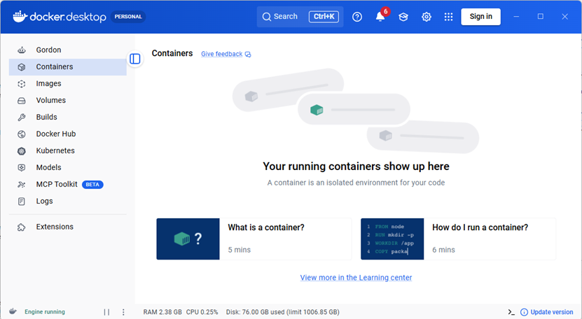
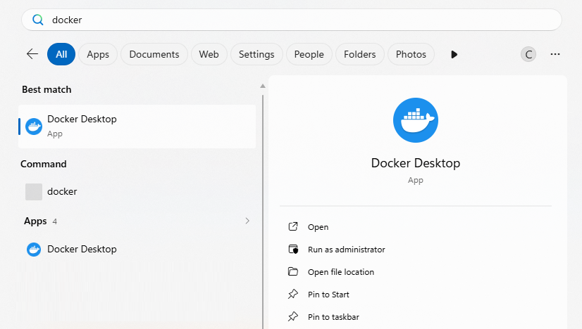

# Installing and using Docker Desktop

## Introduction

[Docker Desktop](https://docs.docker.com/desktop/) is a simple tool to install and manage docker on a windows desktop.
It allows you to see all of the docker container images installed or running on your system.



Docker Desktop provides a great test and tutorial environment and the docker desktop project also provide tutorials which you can follow if you are interested.
Docker Desktop also allows you to run native docker commands from the power shell and, most importantly, pretty much anything you do using docker desktop will also work in a docker engine installed on a linux server.

## Installing and running Docker Desktop

You will find Docker Desktop is already installed on the lab machines but you can easily install it on your own Widows 10 or 11 machine following the [windows install instructions](https://docs.docker.com/desktop/install/windows-install/).
(Note, you will need to ensure that windows `wsl2` service is running on the machine).

It is also possible to install [Docker Desktop on an Apple MAC](https://docs.docker.com/desktop/setup/install/mac-install/), but you do need to ensure your containers support the correct processor. Docker Desktop offers a native ARM-based (Apple Silicon) version for M1, M2, M3, and M4 Macs, alongside a separate Intel (x86_64) version for older Mac models. When you download Docker Desktop, you can choose the Apple Silicon installer (arm64), which runs natively on M-series chips.

Before you can run docker, you need to start docker desktop. 
Use the windows search bar to find and start the application. 
Leave it running for all of the exercises.



## Using the command line to start containers

Having started docker desktop, you can run commands from powershell.

a) First we will start a simple ubuntu 22.04 container in power shell. 
( we are using this image because it is known to work on the lab machines)
This will download the ubuntu 22.04 image if it not present on the machine and start it with an interactive shell:

```
docker run -it ubuntu:22.04
Unable to find image 'ubuntu:22.04' locally
22.04: Pulling from library/ubuntu
cf1a5487baaf: Pull complete
637115e4c229: Download complete
Digest: sha256:0a9887931b0e38af2e3487ed39e29436b0535c4f3f52e57745baaf79d1898956
Status: Downloaded newer image for ubuntu:22.04
root@1793d925ed1e:/#
```

`docker run -it` specifies to run an interactive terminal process in the container. 
You will see that you are landed in a terminal session as the root user.

We specified the container `ubuntu:22.04`.
This has been downloaded from docker hub where many images are contributed by the community.

You can see this image's details at [https://hub.docker.com/_/ubuntu](https://hub.docker.com/_/ubuntu)

If you just wanted to download a container without running it you could use

```
docker pull ubuntu:22.04
```

b) Try entering `ifconfig`

You will probably notice that it says the command Is not found. 
The Ubuntu container comes with a very limited set of utilities.
Just like an ubuntu VM, we need to install features using `apt`

```
# Firstly update the docker container: (note you don’t need to use sudo as you are using the container as root user)

apt update

#Then to install networking tools
apt install net-tools
```

Try `ifconfig` again.

Note the ip address of interface eth0 (this can be used to communicate with other containers)

c) Try looking at the routing table

```
route -n

Kernel IP routing table
Destination     Gateway         Genmask         Flags Metric Ref    Use Iface
0.0.0.0         172.17.0.1      0.0.0.0         UG    0      0        0 eth0
172.17.0.0      0.0.0.0         255.255.0.0     U     0      0        0 eth0
```

You will see that the gateway is `172.17.0.1`. This is actually the address of the host machine on the docker network.

d) Try pinging the host computer at `172.17.0.1` – it won’t work because ping is not installed.

```
apt install iputils-ping

ping 172.17.0.1
```

e) Enter `exit` to leave the Docker container and return to the host OS.

It is important to note that when you exit the container, it is shut down and all of the changes you made to the internals of the container are lost if the container is deleted.

Normally containers only run one application process and when the process is exited, the container stops.
You can however run a container as a daemon with the `-d` flag, which means it will keep running after you exit the shell

```
docker run -it -d ubuntu:22.04
```
This will run the container in the background and return to the prompt.

f) You can see all the containers that are running using the `docker ps` command

```
docker ps
CONTAINER ID   IMAGE          COMMAND       CREATED         STATUS         PORTS     NAMES
02e41d3ef679   ubuntu:22.04   "/bin/bash"   9 seconds ago   Up 8 seconds             goofy_almeida
```
g) You can then open an interactive terminal session in the running container using its ID

In this case we are running `bash` as our terminal

```
docker exec -it 02e41d3ef679 bash
root@02e41d3ef679:/#
```
h) If you exit the container from the terminal, it will still be running. (check with `docker ps`)

You need to `stop` or `kill` the container to shut it down using its id. 
(`stop` tries to do the shutdown gracefully before using `kill` which brutally shuts down the container - like turning off the power). 

```
docker stop 02e41d3ef679
```
g) Now we will try and install apache on the container

```
docker run -it -d -p 8081:80 --name ubuntu1 ubuntu:22.04
```
Note that the `--name ubuntu1` option allows us to use a simple name `ubuntu1` rather then the container ID.

The `-p 8081:80` command maps the internal port 80 to port 8081 on the host computer.
We will need this port to access apache.

Now we can get a terminal in the running container and install apache

```
docker exec -it ubuntu1 bash

# install apache 2
apt update
apt install apache2

# start apache2 - (note that systemd is not installed. This uses the old initd service command)
service apache2 start
```

You should now be able to browse to [http://localhost:8081/](http://localhost:8081/) on your host computer.

If you install `net-tools`, as above, you can find the ip address of the container.

You should also be able to browse to this address as it is on a network visible to the host.
But remember, Apache runs on port 80 on the container.
If the ip address of the container is `172.17.0.2` then use [http://172.17.0.2:80](http://172.17.0.2:80)

At the end of the exercise, you must remember to shut down the container. 
First `exit` the ubuntu terminal then stop the container using.

```
docker stop ubuntu1
```
Check it has stopped using `docker ps`


# Building containers using docker

We have seen that you can install software on containers in a similar way you could in a complete operating system. 
However we have also seen that any configuration you do in a running container is lost when the container shuts down.
Docker provides tools to allow us to create new container images which are permanently available for us to use.
The way to control this is through a `Dockerfile`

(This example is inspired by [dockerizing apache on ubuntu 2204](https://dev.to/donfiealex/dockerizing-apache-on-ubuntu-2204-a-practical-approach-2gbf)

Create a folder called `docker-apache` and inside that folder create a file called `Dockerfile` with the following contents

```
# start with the official apache base image
FROM ubuntu:22.04

# Install apache2
RUN apt-get update && apt-get install -y apache2

# expose port 80 on the container for the web server
EXPOSE 80

# start apache in the foreground when the container starts
CMD ["apachectl", "-D", "FOREGROUND"]

```

Now inside the `docker-apache` folder, run the command

```
docker build -t my-apache .
```
(note the `.` is important - it tells docker that the Dockerfile is in the current folder.)

After the container is built, we can run it using

```
 docker run -d -p 8081:80 --name apache-1 my-apache
```
And access it as before using [http://localhost:8081/](http://localhost:8081/)

We could then run a second container 

```
 docker run -d -p 8082:80 --name apache-2 my-apache
```
And access it  using [http://localhost:8082/](http://localhost:8082/)

We can see both containers using `docker ps`

```
docker ps

CONTAINER ID   IMAGE       COMMAND                  CREATED          STATUS          PORTS                                     NAMES
00063a00c884   my-apache   "apachectl -D FOREGR…"   24 seconds ago   Up 23 seconds   0.0.0.0:8082->80/tcp, [::]:8082->80/tcp   apache-2
14862a562a4a   my-apache   "apachectl -D FOREGR…"   39 seconds ago   Up 38 seconds   0.0.0.0:8081->80/tcp, [::]:8081->80/tcp   apache-1
```

After this we need to stop both containers

```
docker stop apache-1
docker stop apache-2
```

## removing old containers

It is important to realise that even though a container is stopped, it is still present in the file system.
THis can result in a lot of space being used on your disk without you noticing

You can still present but stopped containers using `docker container ps --all`

```
docker container ps --all
CONTAINER ID   IMAGE          COMMAND                  CREATED             STATUS                           PORTS     NAMES
00063a00c884   my-apache      "apachectl -D FOREGR…"   5 minutes ago       Exited (137) 2 minutes ago                 apache-2
14862a562a4a   my-apache      "apachectl -D FOREGR…"   5 minutes ago       Exited (137) 2 minutes ago                 apache-1
3d518215087c   my-apache      "apachectl -D FOREGR…"   10 minutes ago      Exited (137) 6 minutes ago                 xenodochial_herschel
bc8469373772   ubuntu:22.04   "/bin/bash"              About an hour ago   Exited (137) 45 minutes ago                ubuntu1
02e41d3ef679   ubuntu:22.04   "/bin/bash"              About an hour ago   Exited (137) About an hour ago             goofy_almeida
1793d925ed1e   ubuntu:22.04   "/bin/bash"              2 hours ago         Exited (0) 2 hours ago                     elated_swirles
```
You can start stopped containers using their ID or name . e.g.

```
docker start apache-2

docker ps

CONTAINER ID   IMAGE       COMMAND                  CREATED          STATUS         PORTS                                     NAMES
00063a00c884   my-apache   "apachectl -D FOREGR…"   11 minutes ago   Up 7 seconds   0.0.0.0:8082->80/tcp, [::]:8082->80/tcp   apache-2
```

Often however, we want to completely remove old containers.
There are three options to consider

* To remove one stopped container `docker rm <container name or id>`  e.g `docker rm apache-1` (note you must stop it first).
* To remove all stopped containers `docker container prune` This will remove all stopped containers and should work on all platforms the same way.
* For a complete clean use `docker system prune` which will clean up all unused containers, networks, images (both dangling and unreferenced), and optionally, volumes, in one command.

Finally, if you want a container to automatically be removed when it shuts down use `docker run --rm` option e.g. `docker run --rm -d -p 8083:80 --name apache-3 my-apache`
When you stop the container, it will be deleted automatically.


